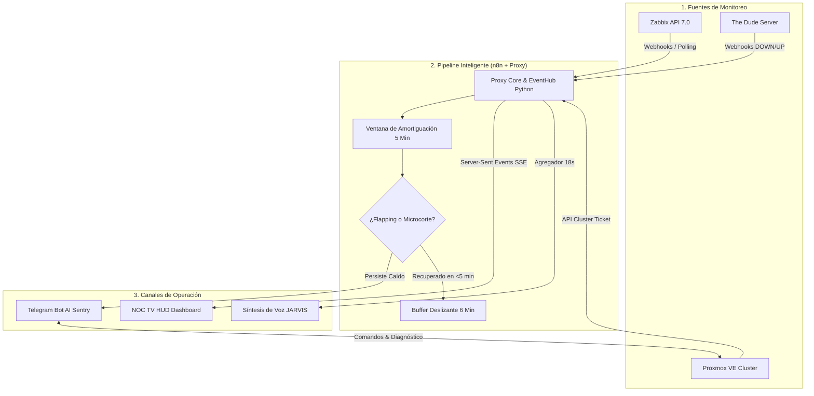

# 🚀 NOC Automation & Intelligent Operations Suite

[](https://www.python.org/)
[](https://n8n.io/)
[](https://www.zabbix.com/)
[](https://www.proxmox.com/)
[](https://core.telegram.org/bots)
[](https://www.docker.com/)

Plataforma integral de **automatización, correlación inteligente de alertas y gestión interactiva para centros de operaciones de red (NOC)**. Integra telemetría de **Zabbix** y **The Dude**, control de hipervisores **Proxmox VE**, pipelines de mitigación de *flapping* en **n8n**, un asistente de operaciones en **Telegram** con Inteligencia Artificial y un **Dashboard TV** interactivo con síntesis de voz en tiempo real (*TTS*).

---

## 📌 Arquitectura del Sistema



---

## 🌟 Características Principales

### 1. Pipeline Inteligente Anti-Flapping (n8n Workflow 1)
* **Ventana de Gracia de 5 Minutos:** Retiene alertas de acceso (CPEs y routers perimetrales) para evitar spam masivo de microcortes.
* **Supresión Automática:** Si un enlace o CPE se restablece antes de cumplirse los 5 minutos, el incidente se silencia sin saturar a los operadores de guardia.
* **Priorización de Infraestructura Crítica:** Los equipos troncales (Core Switches, Routers de Distribución, Hipervisores) se procesan con prioridad alta inmediata.
* **Filtro Estricto de Recuperación:** Solo se emite notificación de *«RECUPERADO»* si la alerta de caída previa fue efectivamente despachada al canal.

### 2. Sentry AI: Asistente Operativo en Telegram (n8n Workflow 2)
* **Control de Hipervisores Proxmox VE:**
  * Diagnóstico en vivo de consumo de CPU, RAM, estado y uptime de máquinas virtuales (VMs) y contenedores (LXCs).
  * Protocolo seguro de **doble confirmación** para acciones críticas (`start`, `shutdown`, `stop`, `reboot`, `reset`).
  * Generación dinámica de enlaces de consola interactiva NoVNC.
* **Telemetría y Diagnóstico de Red en Vivo:**
  * Ping nativo e ICMP vía API de Zabbix.
  * Inspección de interfaces y consumo de ancho de banda (Mbps) en tiempo real.
* **Memoria de Incidentes Recientes:** Permite a los operadores consultar: *«¿Qué alertas han llegado en los últimos minutos?»* recibiendo tarjetas limpias y estructuradas con emojis.

### 3. NOC TV HUD: Dashboard Visual & Síntesis de Voz
* **Panel de Puestos de Operación:** Visualización estilo sala de control con estaciones interactivas (Historial, Zabbix, Proxmox, Ping, Tráfico).
* **Transmisión de Eventos en Tiempo Real (SSE):** El agente en pantalla se desplaza físicamente al puesto correspondiente cuando se ejecuta una consulta o se registra una alarma.
* **Coordinador de Voz Inteligente (JARVIS):** Agrupa ráfagas de incidentes en una ventana de 18 segundos y redacta locuciones en español neutro profesional, evitando leer códigos o símbolos técnicos.

---

## 📂 Estructura del Repositorio

```text
├── dashboard/
│   └── oficina_noc.html         # Frontend del TV HUD con animaciones y Web Speech API
├── proxy/
│   ├── Dockerfile               # Imagen Docker para el proxy de telemetría
│   └── proxy.py                 # Core de sincronización, Proxmox API, EventHub y TTS
├── workflows/
│   ├── workflow-1-smart-alerts.json   # Pipeline n8n de alertas inteligentes y anti-flapping
│   └── workflow-2-ai-bot.json         # Pipeline n8n del bot conversacional con LangChain
├── .env.example                 # Plantilla de variables de entorno (sin credenciales)
├── docker-compose.yml           # Despliegue unificado de la suite
└── README.md                    # Documentación técnica del proyecto
```

---

## 🚀 Despliegue Rápido

### Prerrequisitos
* Docker y Docker Compose
* Instancia de Zabbix 6.x / 7.x con API habilitada
* Clúster Proxmox VE con credenciales de lectura/operación
* Bot de Telegram creado vía [@BotFather](https://t.me/BotFather)

### Pasos de Instalación

1. **Clonar el repositorio:**
   ```bash
   git clone https://github.com/cristiangsalinasv/noc-automation-ai.git
   cd noc-automation-ai
   ```

2. **Configurar variables de entorno:**
   ```bash
   cp .env.example .env
   # Edita .env con tus URLs, tokens de Zabbix, Proxmox y Telegram
   ```

3. **Iniciar los servicios:**
   ```bash
   docker-compose up -d
   ```

4. **Importar Workflows en n8n:**
   * Accede a `http://localhost:5678`.
   * En la sección **Workflows**, selecciona **Import from File**.
   * Importa `workflows/workflow-1-smart-alerts.json` y `workflows/workflow-2-ai-bot.json`.
   * Configura las credenciales de Telegram y activa ambos workflows.

5. **Abrir el Dashboard TV:**
   * Accede en tu navegador o pantalla del NOC a: `http://localhost:11440/tv`.

---

## 👤 Autor

**Cristian Gabriel Salinas Velasquez**  
*Administrador de Infraestructura TI & Redes | Soporte y Telecomunicaciones*  
* Caracas, Venezuela  
* [LinkedIn](https://linkedin.com) · [Email](mailto:Cristiangsalinasv@gmail.com)
