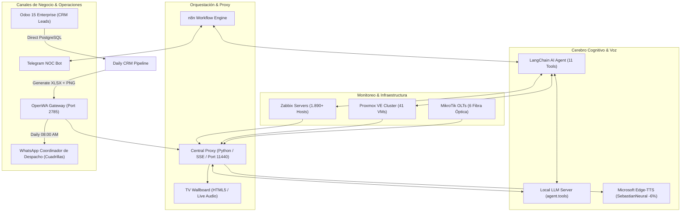

#  NOC Automation & AI Operations Platform

[](LICENSE)
[](https://python.org)
[](https://n8n.io)
[](https://docker.com)
[](https://openwa.dev)

A comprehensive enterprise-grade Operations Center (NOC) automation platform that bridges local **Large Language Models (LLM)**, **Neural Text-to-Speech (TTS)**, **Zabbix Network Telemetry**, **Proxmox Hypervisor Actions**, **Odoo CRM ERP Integration**, and **Multi-tenant WhatsApp Messaging**.

---

##  Architecture Overview



---

##  Key Modules

### 1.  CRM Odoo Installation Dispatcher (`crm/`)
* **Database Direct Connection:** Queries PostgreSQL directly inside LAN bypassing public Cloudflare WAF challenges (0.2s query latency).
* **Plantilla 'PLANIF INSTALACIONES' (ID 610):** Filters stage `Aprobado` (Stage 6) for Fiber and Radio Frequency teams.
* **Intelligent Quadrilla Assignment:**
  * **Solo Fibra:** Strict fiber-only assignments (Alejandro Gómez / Daniel Herrera).
  * **Mixta:** Fiber & Radio Frequency capable (Carlos Mendoza / Roberto Silva).
  * **Rotating Assistants:** Even rotation between Luis Ramírez & Manuel Torres.
  * **Geo-clustering:** Groups installations in the same geographical sector (e.g. Sector Norte, Distrito Centro) to avoid cross-city transit.
* **Dual Deliverables:** Generates styled corporate `.xlsx` (openpyxl) and high-res summary `.png` image (matplotlib) delivered via WhatsApp at 08:00 AM daily via systemd timer.

### 2.  NOC TV Wallboard & Sentry Voice Brain (`proxy/` & `dashboard/`)
* **Real-time Ticket Classification:** Parses inbound messages from WhatsApp *Soporte Interno TI*, extracting applicant name, department, office, and core issue with 0% hallucination.
* **High-Fidelity Audio Synthesis:** Powered by `es-VE-SebastianNeural` with `-6%` speed cadence and local MP3 caching.
* **Live Operations Dashboard:** Displays aggregated traffic of 6 fiber OLTs, Proxmox status, PBS backups, and animated avatar locution.

### 3.  n8n Autonomous Engineering Workflows (`workflows/`)
* **Workflow 1: Reception & Security (`workflow-1-reception-pin.json`):** Telegram trigger, PIN authentication, immediate feedback, PDF/PNG delivery.
* **Workflow 2: Cognitive AI Agent (`workflow-2-ai-agent-tools.json`):** LangChain Agent with 11 tools: Ping, Traffic (Tx/Rx), Zabbix Problems, Host Search, Network Topology, Proxmox VM Actions, and Datacenter Environmental Sensors.
* **Workflow 3: Smart Alerts & Anti-Flapping (`workflow-3-smart-alerts.json`):** Real-time Zabbix & The Dude webhook ingestion with 30s micro-flap filtering and AI-enriched incident summaries.

### 4.  Multi-tenant WhatsApp Gateway (`openwa/`)
* Runs in Docker on port `2785`, supporting concurrent REST API endpoints (`/send-text`, `/send-image`, `/send-document`) for multi-server alert dispatches without disconnections.

---

##  Quick Start Guide

### Prerequisites
* Docker & Docker Compose
* Python 3.11+
* PostgreSQL 12+ (Odoo)
* Zabbix 6.x / 7.x API access

### Installation
1. Clone the repository:
   ```bash
   git clone https://github.com/Cristiangabs/noc-automation-ai.git
   cd noc-automation-ai
   ```
2. Copy environment template and configure your credentials:
   ```bash
   cp .env.example .env
   nano .env
   ```
3. Start the services:
   ```bash
   docker compose up -d
   ```
4. Install Python dependencies:
   ```bash
   pip install -r proxy/requirements.txt
   ```
5. Enable CRM daily dispatch service:
   ```bash
   sudo cp crm/daily-crm-report.service /etc/systemd/system/
   sudo cp crm/daily-crm-report.timer /etc/systemd/system/
   sudo systemctl daemon-reload
   sudo systemctl enable --now daily-crm-report.timer
   ```

---

##  Security & Data Privacy
This repository contains **strictly sanitized code templates**. All passwords, tokens, API keys, client identifiers, and phone numbers have been stripped and replaced with environment variables.

---

##  License
Released under the [MIT License](LICENSE).
