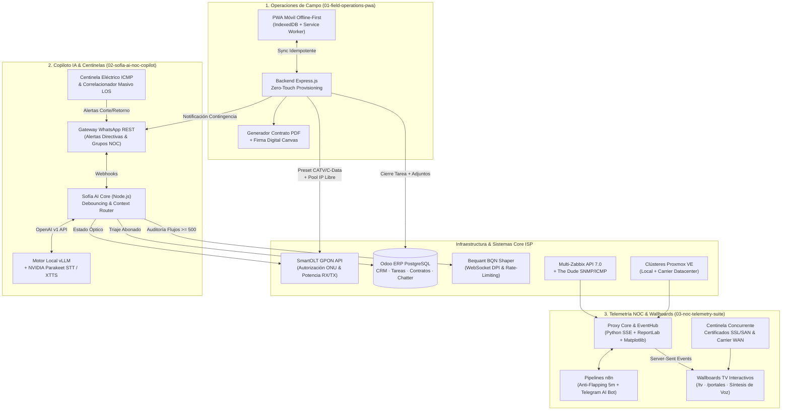

# 🚀 Telecom & NOC Intelligent Operations Suite (`noc-automation-ai`)

[](https://nodejs.org/)
[](https://www.python.org/)
[](https://www.postgresql.org/)
[](https://www.zabbix.com/)
[](https://www.proxmox.com/)
[](https://n8n.io/)
[](https://github.com/vllm-project/vllm)

Plataforma integral **End-to-End de Automatización para Proveedores de Servicios de Internet (ISP) y Centros de Operaciones de Red (NOC)**.

Este monorepo consolida en una sola arquitectura de producción tres capas críticas de ingeniería de telecomunicaciones:
1. **Operaciones de Campo FTTH/RF (`01-field-operations-pwa`)**: Aplicación móvil PWA *Offline-First* para cuadrillas técnicas con aprovisionamiento GPON cero-errores en **SmartOLT**, asignación libre de colisiones IP y cierre transaccional en **Odoo ERP** con contratos PDF firmados digitalmente.
2. **Sofía AI — Copiloto NOC & Centinela de Red (`02-sofia-ai-noc-copilot`)**: Asistente de Inteligencia Artificial local (**vLLM** + **STT/TTS**) integrado en WhatsApp para atención de nivel 1 y copiloto de ingeniería en grupos técnicos, con correlación automática de cortes de fibra (**LOS**), apagones eléctricos (**ICMP Sentinel**) y auditoría de tráfico DPI (**Bequant BQN**).
3. **Suite de Telemetría NOC, Wallboards & Anti-Flapping (`03-noc-telemetry-suite`)**: Backend asíncrono en Python + pipelines **n8n** con amortiguación de microcortes, **Wallboard TV** con síntesis de voz en vivo, diagnóstico automático de enlaces **Carrier WAN / Proxmox** y centinela concurrente de **Certificados SSL/SAN**.

---

## 🏛️ Arquitectura Global del Ecosistema



---

## 📦 Módulos del Monorepo

### 1️⃣ [`01-field-operations-pwa`](./01-field-operations-pwa) — Field Service & Zero-Touch FTTH Provisioning
Aplicación web progresiva (PWA) diseñada para operar en zonas sin cobertura móvil (sótanos, cuartos de telecomunicaciones) y automatizar el 100% del alta técnica del abonado:
* **Algoritmo de Asignación Diaria y Balanceo de Cuadrillas**: Consulta oportunidades aprobadas en Odoo CRM (`crm_lead`), clasifica instalaciones por tecnología (`FTTH` vs `Radio Frecuencia`) y balancea automáticamente la carga entre cuadrillas con rotación diaria de ayudantes.
* **Aprovisionamiento GPON Cero-Colisiones**:
  * Detección automática del fabricante de la ONU (`C-Data` vs `VSOL/CATV`) y selección dinámica del *Preset* en **SmartOLT**.
  * Cruce bidireccional en tiempo real entre **SmartOLT** y **Odoo** (`project_task` + `sale_subscription`) para asignar la primera IP fija disponible del pool correspondiente a cada OLT, garantizando **0% de colisiones de IP**.
* **Sincronización Offline Idempotente (`IndexedDB` + `Service Worker`)**:
  * Almacena localmente evidencias fotográficas, coordenadas GPS, test de velocidad HTML5 y firma del cliente en `IndexedDB` cuando no hay señal.
  * **Blindaje de Idempotencia en Backend**: Previene que reenvíos tardíos sobrescriban fechas históricas (`COALESCE(fecha_instalacion, NOW())`), evita duplicar adjuntos en `ir_attachment` y bloquea re-notificaciones por WhatsApp, respondiendo `{ alreadyInstalled: true }` para purgar limpiamente la cola del dispositivo.
* **Wallboard de Despacho en Vivo (`/wallboard.html`)**: Panel de seguimiento en tiempo real mediante *Server-Sent Events (SSE)* con KPIs diarios de instalaciones completadas, en sitio y pospuestas.

---

### 2️⃣ [`02-sofia-ai-noc-copilot`](./02-sofia-ai-noc-copilot) — AI NOC Assistant, DPI Auditor & Network Sentinel
Copiloto operativo dual (Atención al Cliente Nivel 1 + Copiloto de Ingeniería en Grupos Técnicos) conectado a un servidor de inferencia local **vLLM**:
* **Diagnóstico Unificado de Abonados (`customerLookupService.js`)**: Extrae cédula, código de contrato (`SUB`) o nombre desde lenguaje natural y cruza en milisegundos el estado administrativo/facturación en **Odoo** con la telemetría óptica en vivo en **SmartOLT** (potencia RX/TX en dBm, estado `Online`, `Dying Gasp` o `LOS`).
* **Correlacionador de Cortes Masivos y Centinela Eléctrico**:
  * `smartoltMonitor.js`: Sondea las OLTs cada 60 segundos; si detecta más de 5 ONUs caídas simultáneamente en una misma zona, declara automáticamente una avería masiva o apagón zonal y alerta a los grupos técnicos.
  * `sentinelPowerMonitor.js`: Sondeo ICMP de alta frecuencia (cada 20s) hacia la ONU centinela de referencia. Detecta cortes eléctricos al instante y, al restablecerse el fluido, calcula y reporta la duración exacta de la interrupción.
* **Auditoría de Sobreconsumo con Bequant BQN (`bequantReportService.js` + `generate_bequant_pdf.py`)**:
  * Conexión vía WebSocket seguro (`WSS`) al shaper DPI **Bequant BQN** para filtrar suscriptores con exceso de sesiones concurrentes (`FLOWS >= 500`), extraer series temporales de ancho de banda y generar automáticamente un dossier PDF ejecutivo enviado por WhatsApp.
* **Diagnóstico Automatizado de Carrier WAN (`cirionDiagnosticService.js` + `generate_cirion_card.py`)**:
  * Verifica por SSH el quórum del clúster **Proxmox VE** en el datacenter externo y ejecuta pruebas ICMP cruzadas hacia el gateway interno y la IP pública del carrier para emitir una tarjeta gráfica con veredicto automático (*Falla de Carrier Externo* vs. *Red Interna Operativa*).
* **Procesamiento de Voz Local (`audioService.js`)**: Transcripción de notas de voz de WhatsApp mediante **NVIDIA Parakeet (STT)** y síntesis de voz con **XTTS-v2**.
* **Autoaprendizaje Nocturno (`learningService.js`)**: Consolida cada mañana a las 07:00 AM las métricas de caídas ópticas, cortes eléctricos y tiempos medios de recuperación (MTTR), inyectando las lecciones aprendidas en el prompt del sistema.

---

### 3️⃣ [`03-noc-telemetry-suite`](./03-noc-telemetry-suite) — Real-Time NOC Wallboards, SSL Sentinel & Anti-Flapping
Suite de visualización para pantallas de sala de control y orquestación de alertas:
* **Proxy Asíncrono, EventHub & Generador de Reportes (`proxy/proxy.py`)**:
  * Conector JSON-RPC con **Zabbix 7.0** para consulta inteligente de interfaces, cálculo de percentiles y generación bajo demanda de gráficas PNG (`Matplotlib`) y reportes ejecutivos PDF (`ReportLab`).
  * Integración con **Proxmox VE API** para telemetría de nodos y control seguro de VMs/LXCs.
* **NOC TV HUD con Síntesis de Voz (`dashboard/oficina_noc.html`)**:
  * Interfaz visual animada conectada por *Server-Sent Events (SSE)* donde el avatar del operador se desplaza en tiempo real hacia la estación de trabajo que genera un evento (Zabbix, Proxmox, Ping, Tráfico).
  * **Coordinador de Voz Inteligente**: Agrupa ráfagas de incidentes en ventanas de 18 segundos y pronuncia locuciones claras por los parlantes del NOC sin leer símbolos ni códigos crudos.
* **Centinela Concurrente de Portales Web y Certificados SSL/SAN (`checkers/web_ssl_checker.py` + `dashboard/web_portales_dashboard.html`)**:
  * Inspección multihilo (`ThreadPoolExecutor`) de portales gubernamentales y corporativos.
  * Validación profunda de certificados X.509 (`cryptography`): días restantes de vigencia, emisor, Common Name (CN) y verificación estricta de **Subject Alternative Names (SAN)** para detectar errores de *Hostname Mismatch* (`ERR_CERT_COMMON_NAME_INVALID`) incluso cuando el certificado no ha expirado.
* **Pipelines Inteligentes en n8n (`workflows/`)**:
  * `workflow-1-smart-alerts.json`: Ventana de amortiguación de 5 minutos (*Anti-Flapping*) que silencia microcortes fugaces en equipos de acceso y prioriza alertas de infraestructura troncal.
  * `workflow-2-ai-bot.json`: Bot conversacional de operaciones en Telegram con herramientas conectadas a Zabbix y Proxmox (con protocolo de doble confirmación para reinicio/apagado de contenedores).

---

## 🛠️ Stack Tecnológico

| Capa | Tecnologías e Integraciones |
| :--- | :--- |
| **Backend & Servicios** | Node.js (Express), Python 3.11 (`http.server`, `concurrent.futures`, `cryptography`), WebSockets (`ws`), SSH2 |
| **Frontend & Móvil** | HTML5, CSS3 Moderno, Vanilla JavaScript ES6+, Progressive Web App (PWA), Service Workers, `IndexedDB`, `HTML5 Canvas`, `Web Speech API` |
| **Redes & Telecom (ISP)** | **SmartOLT REST API** (GPON/FTTH), **Bequant BQN** (WSS DPI/TCP Optimization), **Zabbix 7.0 JSON-RPC**, **The Dude**, **MikroTik / pfSense / Fortinet** |
| **Virtualización & ERP** | **Proxmox VE API & Cluster (`pvecm`/`qm`/`pct`)**, **Odoo ERP** (`PostgreSQL 14` — `crm_lead`, `project_task`, `sale_subscription`, `ir_attachment`) |
| **Inteligencia Artificial** | **vLLM** (OpenAI-compatible API), **NVIDIA Parakeet** (ASR/STT), **Coqui XTTS-v2** (TTS), **n8n** + LangChain |
| **Reportería & Gráficos** | `Matplotlib`, `ReportLab`, `Pillow (PIL)`, `SheetJS (xlsx)`, `HTML5-QRCode` |

---

## 🚀 Guía de Inicio Rápido

### 1. Clonar el repositorio y configurar variables de entorno
```bash
git clone https://github.com/Cristiangabs/noc-automation-ai.git
cd noc-automation-ai
cp .env.example .env
```
> 🔒 **Nota de Seguridad:** Todos los módulos leen sus credenciales, direcciones IP y tokens desde variables de entorno. Ningún archivo del repositorio contiene contraseñas, IPs privadas reales ni datos sensibles de clientes.

### 2. Ejecutar la PWA de Operaciones de Campo (`01-field-operations-pwa`)
```bash
cd 01-field-operations-pwa
npm install
npm start
# App Móvil disponible en: http://localhost:3000
# Wallboard de Despacho en: http://localhost:3000/wallboard.html
```

### 3. Ejecutar el Copiloto IA Sofía (`02-sofia-ai-noc-copilot`)
```bash
cd 02-sofia-ai-noc-copilot
npm install
npm start
# Servicio escuchando webhooks y simulaciones en: http://localhost:11450/health
```

### 4. Desplegar la Suite de Telemetría NOC y Dashboards (`03-noc-telemetry-suite`)
```bash
cd 03-noc-telemetry-suite
docker-compose up -d
# NOC TV Wallboard: http://localhost:11440/tv
# Centinela SSL/SAN: python3 checkers/web_ssl_checker.py --once
```

---

## 👤 Autor

**Cristian Gabriel Salinas Velasquez**  
*Administrador de Infraestructura TI, Redes & Automatización de Telecomunicaciones*  
📍 Caracas, Venezuela  
📧 [Cristiangsalinasv@gmail.com](mailto:Cristiangsalinasv@gmail.com) · 🔗 [GitHub `@Cristiangabs`](https://github.com/Cristiangabs)
